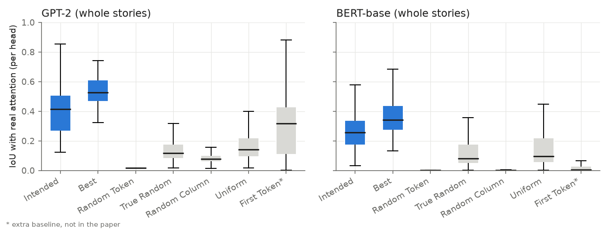
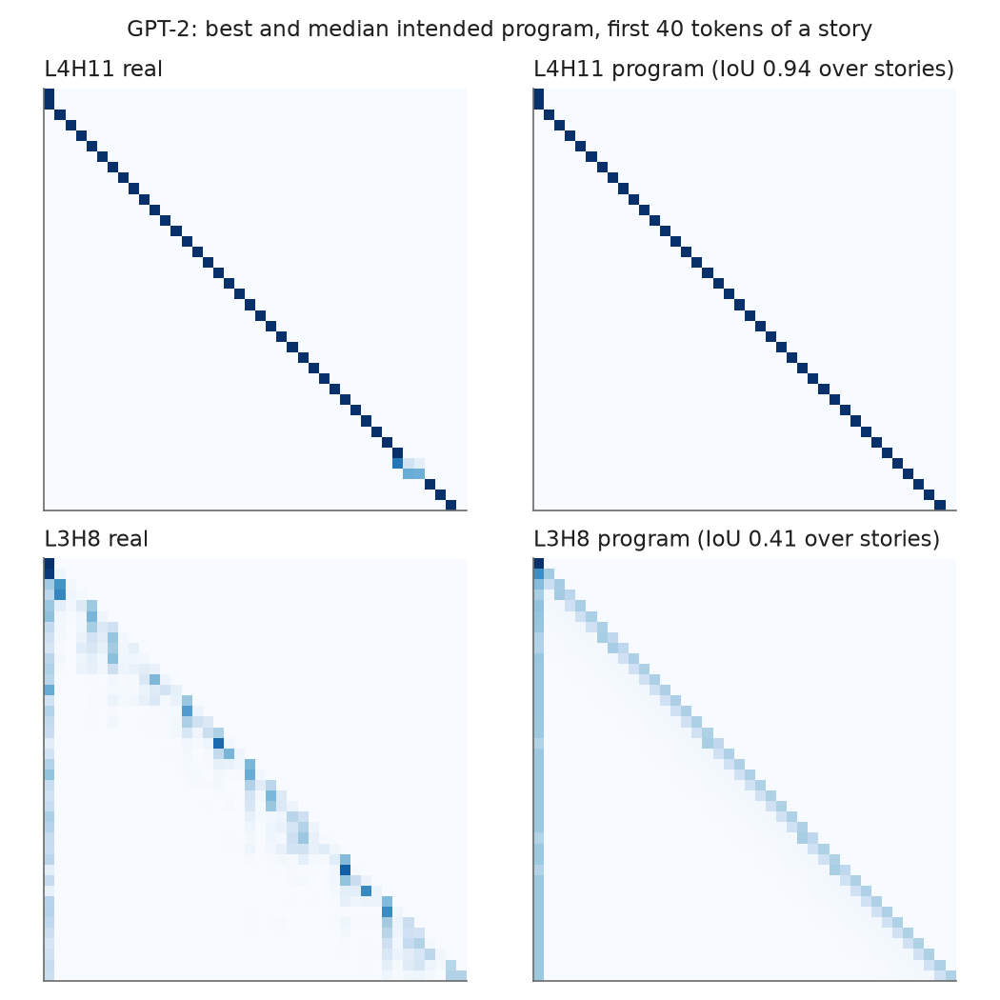
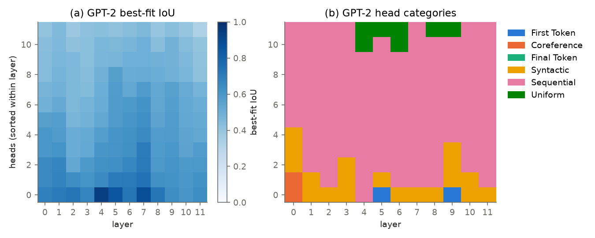
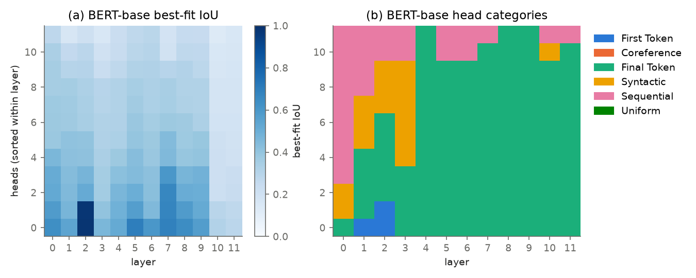
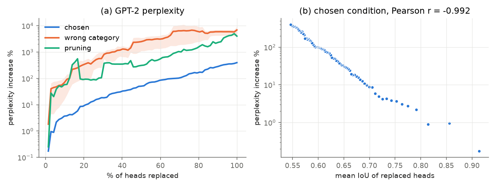
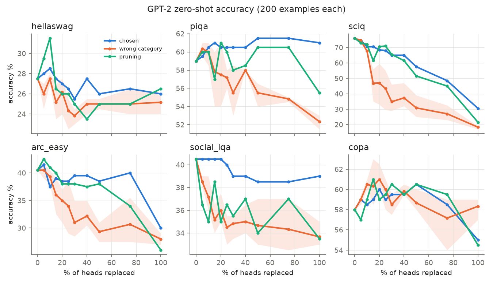

# Explaining Attention with Program Synthesis: a laptop-scale replication

This is an independent replication of **Hayes, Li & Andreas, "Explaining Attention with Program Synthesis"** ([arXiv:2606.19317](https://arxiv.org/abs/2606.19317)) on **GPT-2 small** and **BERT-base-uncased**. It covers every step except the larger models: per-head program synthesis with an LLM, the library cross-match, baselines, categorization, and causal head replacement measured by perplexity and six zero-shot benchmarks.

The method: for each attention head, an LLM is shown samples of the head's attention patterns and writes a Python function `predict_attention_map(sentence) -> (tokens, matrix)`. The function runs in a sandbox and is scored by IoU against the real attention, then refined once from its best and worst examples. The resulting programs can stand in for the heads inside the model.

Everything ran on an Apple M1 laptop with 16 GB RAM, on CPU. Program synthesis used **Claude Haiku 5.5** (effort `low`) for a total API cost of **about $1**; the paper used Claude Sonnet 4 and spent about $150 across four models.

## Results at a glance

| Claim | Paper | This replication |
|---|---|---|
| Synthesized programs beat every baseline in IoU (Fig. 3) | yes | yes, for GPT-2 and BERT |
| A program written for another head is often a better fit (Table A.6) | best ≠ intended on 95.8% of GPT-2 heads | 91.0% |
| Mean intended / best IoU, GPT-2 (Table A.6) | 0.46 / 0.61 | 0.40 / 0.55 |
| Median intended / best IoU, BERT (Fig. 3) | ≈0.22 / ≈0.27 | 0.26 / 0.34 |
| Perplexity increase with 25% of heads replaced | about 16% (average of 3 models) | **13.7%** (GPT-2) |
| IoU predicts the perplexity cost (Fig. 5b, GPT-2) | r = −0.915 | **r = −0.992** |
| Chosen programs hurt far less than wrong-category programs or pruning | yes | yes, by one to two orders of magnitude in perplexity |
| Category sufficiency check (max cross-category IoU < 0.4) | fails for every model | fails (0.80 GPT-2, 0.71 BERT) |

**Note:** the paper's IoUs match ours only on **whole stories**. Programs are synthesized from single-sentence examples, as in the paper's prompt. Scored on short sentences (~15 tokens), every number inflates: GPT-2's Random Token baseline reaches 0.17, against ≈0.01 in the paper's Fig. 3. On whole held-out TinyStories (median 190 tokens), the baselines fall where Fig. 3 puts them. All headline numbers here are story-level; sentence-level numbers are reported separately below.

## Contents

```
pipeline/              the experiment, one module per step (see "Pipeline" below)
  data.py              M1  TinyStories splits
  extract.py           M2  cache every head's attention
  summarize.py         M4  build the synthesis prompt for one head
  sandbox.py           M5  run a program in an isolated process, validate, cache, score
  llm.py               M6  Claude Haiku 5.5 client with a disk cache
  synthesize.py        M6–M7 generate → refine → select, for one head or all heads in parallel
  crossmatch.py        M8  every program × every head → best-fit program per head
  baselines.py         M9  random / uniform / first-token baselines
  categorize.py        M10 LLM category per program, plus the sufficiency check
  replace.py           M11 swap heads inside GPT-2's forward pass
  perplexity.py        M12 perplexity as heads are replaced
  benchmarks.py        M13 six zero-shot benchmarks as heads are replaced
  plots.py             M15 figures
helpers/attention_helpers.py   functions a synthesized program may call (tokenizers, spaCy alignment, masks)
prompts/               synthesis, refinement and categorization prompts
scripts/               self-checks (environment, helpers, sandbox, synthesis path)
figures/               the figures shown below
```

Generated artifacts are not committed. `data/` holds the splits and benchmark texts; `runs/` holds attention caches, programs, program outputs, the LLM cache and results. Everything in both can be regenerated with the commands below.

## Setup

Requirements: [uv](https://docs.astral.sh/uv/) and macOS or Linux; the sandbox uses `SIGALRM`, which Windows doesn't have. Python 3.11 is pinned in `.python-version`.

```bash
uv sync                                  # Python deps, torch, transformers, spaCy + en_core_web_sm
cp .env.example .env                     # then add your key: ANTHROPIC_API_KEY=...
uv run python scripts/check_env.py       # both models load; attention matrices are well-formed
```

Only synthesis (M6–M7) and categorization (M10) call the API. If `uv run` stalls re-downloading the spaCy wheel, use `uv run --no-sync`.

## Running the pipeline

Each step caches its outputs, so steps can be re-run or resumed. Times are from an Apple M1 laptop (16 GB).

| Step | Command | Time | API cost |
|---|---|---|---|
| M1 data splits | `uv run python -m pipeline.data` | a few min (downloads TinyStories) | — |
| M2 attention cache | `uv run python -m pipeline.extract` | ~1.5 min | — |
| M3–M6 checks | `uv run python -m scripts.check_helpers`<br>`uv run python -m scripts.check_sandbox`<br>`uv run python -m scripts.check_synthesize` | ~1 min each | — |
| One head (example) | `uv run python -m pipeline.synthesize gpt2 4 11` | ~30 s | <$0.01 |
| M7 all heads | `uv run python -m pipeline.synthesize gpt2 all`<br>`uv run python -m pipeline.synthesize bert-base-uncased all` | ~20 min per model | ~$0.5 per model |
| M8 cross-match | `uv run python -m pipeline.crossmatch gpt2 bert-base-uncased` | ~15 min | — |
| M9 baselines | `uv run python -m pipeline.baselines gpt2 bert-base-uncased` | seconds | — |
| M10 categories | `uv run python -m pipeline.categorize gpt2 bert-base-uncased` | ~1 min | ~$0.05 |
| M11 check | `uv run python -m pipeline.replace` | seconds | — |
| M12 perplexity | `uv run python -m pipeline.perplexity gpt2` | ~3.5 h | — |
| M13 benchmarks | `uv run python -m pipeline.benchmarks build`<br>`uv run python -m pipeline.benchmarks gpt2` | ~6 h | — |
| M15 figures | `uv run python -m pipeline.plots` | ~1 min | — |

M12 and M13 are slow because each of the 144 programs runs on every input in its own sandbox (568k program runs), and GPT-2 is re-run at every replacement level and condition.

### Pipeline in brief

1. **Data (M1).** TinyStories ([Eldan & Li, 2023](#references)), split into sentences with spaCy:
   - 100 sentences to build prompts (`synth`), 50 to choose between programs (`val`), and 200 held out (`test`), from the train and validation sets.
   - 50 held-out whole stories (`stories`) for story-level IoU.
   - 150 further held-out stories (`ppl_eval`) for perplexity; these are never used to choose programs.
2. **Attention (M2).** Eager attention from Hugging Face `transformers`, cached as float16. GPT-2 has no BOS token; BERT includes `[CLS]`/`[SEP]`.
3. **Prompt (M4).** The paper's appendix prompt. Per example, the head's strongest edges (top 2.5% plus each row's top 2) are summarized in four quartile bands. Examples are added until the prompt reaches ~4k tokens.
4. **Sandbox and score (M5).**
   - Each program runs in a spawned process with sockets disabled, a temporary working directory, a 5 s limit per input and an overall kill timeout.
   - Each output is checked: tokens must match, the shape must be n×n, entries finite and ≥ 0, the causal triangle respected, and rows summing to 1.
   - Score is IoU = Σmin(A, P) / Σmax(A, P), averaged over inputs; a failure counts as 0.
5. **Synthesis (M6–M7).** One program, then one refinement that shows the two best and two worst examples (real vs predicted). The candidate with the higher `val` IoU becomes the head's *intended* program.
6. **Cross-match (M8).** Every intended program is scored against every head. Each head's *best* program is the argmax: picked on `val` for the sentence results and on `stories` for the story results.
7. **Baselines (M9).** Random Token, True Random (Dirichlet rows), Random Column, Uniform, plus an extra First Token baseline that is not in the paper.
8. **Categories (M10).**
   - Haiku labels each program as one of the paper's six categories. The prompt tells it to ignore the near-universal first-token sink and classify by the program's distinctive rule.
   - A head gets the category of its best-fit program.
9. **Replacement (M11–M13).**
   - A custom attention function, registered through `transformers.AttentionInterface` together with the eager causal mask, overwrites a head's attention with the program's output (or zeros, for pruning) and recomputes `attn @ V`.
   - Heads are replaced greedily in descending best-fit IoU. Three conditions: chosen programs; a random program from a different category (3 seeds); and pruning.
   - Benchmark prompts and log-likelihood scoring follow lm-evaluation-harness.

## Results

### Alignment: IoU with real attention (Fig. 3, Table A.6)



On whole stories:

| | GPT-2 | GPT-2 (paper) | BERT | BERT (paper) |
|---|---|---|---|---|
| Intended program, mean | 0.400 | 0.46 | 0.268 | — |
| Intended program, median | 0.413 | — | 0.256 | ≈0.22 |
| Best program, mean | 0.546 | 0.61 (Table A.6) / 0.69 (text) | 0.363 | — |
| Best program, median | 0.527 | — | 0.342 | ≈0.27 |
| Best ≠ intended | 91.0% | 95.8% | 89.6% | — |
| Random Token | 0.016 | ≈0.01 | 0.003 | ≈0.01 |
| True Random | 0.141 | ≈0.13–0.20 | 0.118 | ≈0.13–0.20 |
| Random Column | 0.090 | — | 0.002 | — |
| Uniform | 0.178 | ≈0.13–0.20 | 0.149 | ≈0.13–0.20 |
| First Token (extra) | 0.293 | — | 0.033 | — |

On 200 held-out sentences:
- **GPT-2:** intended 0.731, best 0.774; the refined program was chosen for 74% of heads.
- **BERT:** intended 0.514, best 0.546; the refined program was chosen for 49% of heads.

As in the paper, programs clearly beat the baselines, BERT is harder to fit than GPT-2, and the best program usually comes from a different head. On GPT-2 the First Token baseline already reaches 0.29, so much of the fit comes from the attention sink. The programs add about 0.25 IoU on top of it.



### Head categories (Fig. 4)




| Category | GPT-2 heads | BERT heads |
|---|---|---|
| Sequential | 114 | 24 |
| Syntactic | 19 | 15 |
| Uniform | 7 | 0 |
| First Token | 2 | 3 |
| Coreference | 2 | 0 |
| Final Token | 0 | 102 |

The paper does not describe how it grouped programs, so this is the least faithful part of the replication. The counts are skewed because a few generic "first-token sink + local window" programs are the best fit for many heads: GPT-2 has only 50 distinct best-fit programs, and one covers 22 heads.

### Causal effect on GPT-2 perplexity (Fig. 5)



Perplexity is measured on 150 held-out stories (31,659 tokens); base perplexity is 10.93.

| Heads replaced | Chosen programs | Wrong category (3 seeds) | Pruning |
|---|---|---|---|
| 10% | +3.7% | +69% | +58% |
| 25% | **+13.7%** | +437% ± 215 | +91% |
| 50% | +50.8% | +2,498% ± 1,235 | +311% |
| 100% | +397% | +6,900% | +4,037% |

The mean IoU of the replaced heads predicts the log perplexity increase with r = −0.992 (paper: −0.915).

### Downstream accuracy on GPT-2 (Fig. 6, Table 1)



**Wrong-category accuracy, mean ± std over 3 seeds (paper Table 1):**

| Level | | HellaSwag | PIQA | SciQ | ARC-Easy | Social IQA | COPA |
|---|---|---|---|---|---|---|---|
| 25% | paper | 0.268±0.026 | 0.563±0.014 | 0.385±0.017 | 0.310±0.031 | 0.370±0.010 | 0.527±0.072 |
| 25% | ours | 0.243±0.016 | 0.572±0.010 | 0.433±0.129 | 0.340±0.048 | 0.345±0.013 | 0.600±0.017 |
| 50% | paper | 0.232±0.012 | 0.508±0.015 | 0.363±0.019 | 0.322±0.008 | 0.362±0.013 | 0.560±0.030 |
| 50% | ours | 0.250±0.005 | 0.555±0.013 | 0.308±0.073 | 0.293±0.018 | 0.347±0.021 | 0.587±0.012 |

**Chosen programs:**

| | HellaSwag | PIQA | SciQ | ARC-Easy | Social IQA | COPA |
|---|---|---|---|---|---|---|
| Unmodified GPT-2 | 0.275 | 0.590 | 0.760 | 0.405 | 0.405 | 0.580 |
| 25% replaced | 0.265 | 0.605 | 0.680 | 0.385 | 0.400 | 0.590 |
| 50% replaced | 0.260 | 0.615 | 0.575 | 0.385 | 0.385 | 0.605 |

- **Chosen programs:** accuracy stays near baseline up to 30–50% replacement on five of six benchmarks. SciQ, with its long support passages, degrades the most.
- **Wrong-category programs:** most cells are within about 0.05 of Table 1.
- **Noise:** with 200 examples per benchmark, one accuracy figure carries about ±3.5 points of noise (95% CI). GPT-2 small is near chance on HellaSwag and COPA even unmodified.

The `acc` metric is shown; `acc_norm` is also computed and tells the same story.

## Deviations from the paper

| Area | Paper | Here |
|---|---|---|
| Models | GPT-2, TinyLlama-1.1B, Llama-3.2-3B, BERT | GPT-2 and BERT only, to fit on a laptop |
| Synthesis LLM | Claude Sonnet 4 | Claude Haiku 5.5, effort `low`: one initial program and one refinement per head |
| Evaluation inputs | Not stated (whole stories, as inferred above) | Sentences for synthesis and selection; whole stories for the comparable IoUs |
| Categories | Synthesis agent groups programs (procedure unspecified) | One LLM label per program, with the first-token sink ignored |
| Benchmarks | Dataset sources and replacement levels not given | 200 seeded examples each; PIQA and Social IQA from parquet mirrors (`baber/piqa`, `baber/social_i_qa`); COPA = SuperGLUE validation + 100 train examples; levels 0, 5, 10, 15, 20, 25, 30, 40, 50, 75, 100% |
| Failed program runs | Not stated | Uniform causal attention for that input (1 failure in 568k runs) |

## References

**The replicated paper**
- Amiri Hayes, Belinda Z. Li, Jacob Andreas. *Explaining Attention with Program Synthesis.* arXiv:2606.19317, 2026. https://arxiv.org/abs/2606.19317

**Models**
- Alec Radford, Jeffrey Wu, Rewon Child, David Luan, Dario Amodei, Ilya Sutskever. *Language Models are Unsupervised Multitask Learners* (GPT-2). OpenAI, 2019.
- Jacob Devlin, Ming-Wei Chang, Kenton Lee, Kristina Toutanova. *BERT: Pre-training of Deep Bidirectional Transformers for Language Understanding.* NAACL 2019. https://arxiv.org/abs/1810.04805

**Data**
- Ronen Eldan, Yuanzhi Li. *TinyStories: How Small Can Language Models Be and Still Speak Coherent English?* arXiv:2305.07759, 2023. https://arxiv.org/abs/2305.07759

**Benchmarks**
- Rowan Zellers, Ari Holtzman, Yonatan Bisk, Ali Farhadi, Yejin Choi. *HellaSwag: Can a Machine Really Finish Your Sentence?* ACL 2019. https://arxiv.org/abs/1905.07830
- Yonatan Bisk, Rowan Zellers, Ronan Le Bras, Jianfeng Gao, Yejin Choi. *PIQA: Reasoning about Physical Commonsense in Natural Language.* AAAI 2020. https://arxiv.org/abs/1911.11641
- Johannes Welbl, Nelson F. Liu, Matt Gardner. *Crowdsourcing Multiple Choice Science Questions* (SciQ). W-NUT 2017. https://arxiv.org/abs/1707.06209
- Peter Clark et al. *Think you have Solved Question Answering? Try ARC, the AI2 Reasoning Challenge.* arXiv:1803.05457, 2018. https://arxiv.org/abs/1803.05457
- Maarten Sap, Hannah Rashkin, Derek Chen, Ronan Le Bras, Yejin Choi. *Social IQa: Commonsense Reasoning about Social Interactions.* EMNLP 2019. https://arxiv.org/abs/1904.09728
- Melissa Roemmele, Cosmin Adrian Bejan, Andrew S. Gordon. *Choice of Plausible Alternatives: An Evaluation of Commonsense Causal Reasoning* (COPA). AAAI Spring Symposium 2011.

**Software**
- Thomas Wolf et al. *Transformers: State-of-the-Art Natural Language Processing.* EMNLP 2020 (System Demonstrations). https://github.com/huggingface/transformers
- Leo Gao et al. *A framework for few-shot language model evaluation* (lm-evaluation-harness). Zenodo, 2023. https://github.com/EleutherAI/lm-evaluation-harness
- Matthew Honnibal, Ines Montani, Sofie Van Landeghem, Adriane Boyd. *spaCy: Industrial-strength Natural Language Processing in Python.* 2020. https://spacy.io
- Anthropic. *Claude Haiku 5.5*, used through the Anthropic API for program synthesis and categorization. https://docs.anthropic.com
